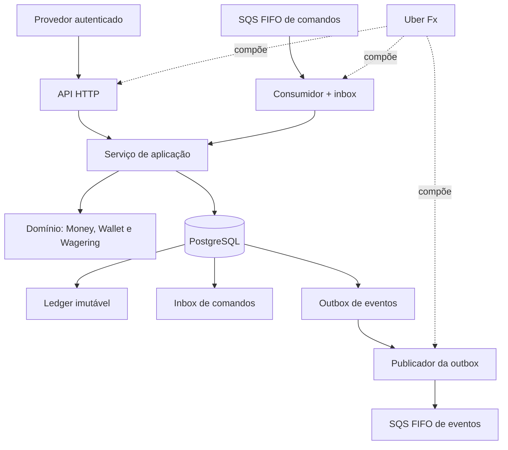

# Arquitetura e decisões técnicas

Este documento registra a arquitetura do Wallet Service, as invariantes que protegem a integridade financeira, as decisões de implementação e as limitações conhecidas. Ele complementa o [`README.md`](README.md), que contém os passos de execução e exemplos de uso.

> **Importante:** “implementado” descreve o comportamento previsto no código. Isso não significa que todos os testes opcionais, o Compose completo ou uma implantação em AWS tenham sido executados em todos os ambientes. Os testes e suas dependências estão descritos no README.

## 1. Objetivo e escopo

O serviço processa operações financeiras de provedores de jogos sobre carteiras de jogadores. A implementação foi desenvolvida a partir do [Backend Challenge da Jungle Gaming](https://github.com/junglegaming/backend-challenge-go), que enfatiza consistência do saldo, integridade do ledger, idempotência persistente, concorrência, mensageria e recuperação de falhas.

O sistema disponibiliza uma API HTTP e um consumidor de comandos SQS. Ambos reutilizam o mesmo serviço de aplicação e as mesmas regras de domínio, para que a origem da operação não altere sua semântica financeira.

## 2. Visão geral

### Princípios

- O PostgreSQL é a fonte persistente da verdade financeira.
- Estado que afeta a correção não depende apenas da memória de uma instância.
- Transações concorrentes são coordenadas por carteira, sem lock global para todas as carteiras.
- O HTTP e o SQS usam o mesmo caso de uso e as mesmas regras do domínio.
- Saldo, transação financeira, ledger e evento de outbox são confirmados atomicamente quando a operação altera o estado financeiro.
- Mensagens podem ser entregues mais de uma vez; a solução não depende exclusivamente da deduplicação temporária do broker.

## 3. Organização em camadas

| Pacote | Responsabilidade |
|---|---|
| `internal/money` | Tipo de valor monetário, parsing e operações aritméticas seguras |
| `internal/wallet` | Entidades e regras do domínio de carteira e ledger |
| `internal/wagering` | Tipos de operação, estados, validações e decisões de domínio |
| `internal/app` | Casos de uso, transações SQL e coordenação entre domínio e persistência |
| `internal/httpapi` | Handlers HTTP, contratos, autenticação e autorização das rotas |
| `internal/auth` | Validação de JWT e obtenção de chaves via JWKS |
| `internal/inbound` | Consumo de mensagens SQS e inbox transacional |
| `internal/outbox` | Reivindicação e publicação de eventos gravados no banco |
| `internal/messaging` | Abstração de fila, adaptador SQS e implementação em memória usada em testes |
| `internal/metrics` | Métricas expostas no formato Prometheus |
| `internal/bootstrap` | Composição das dependências e ciclo de vida com Uber Fx |
| `db/migrations` | Evolução versionada do schema PostgreSQL |

O domínio deve concentrar as regras de negócio sem depender de handlers HTTP ou da implementação do banco. A camada de aplicação orquestra essas regras e mantém as operações persistentes dentro das transações SQL adequadas.

## 4. Dinheiro e precisão

- Os valores são armazenados em `int64` representando centavos, associados a uma moeda de três letras maiúsculas.
- O parsing espera uma string decimal com exatamente duas casas, por exemplo `"25.00"`.
- O parsing rejeita entradas vazias, sinal explícito, notação científica, `NaN`, `Infinity`, escala diferente de duas casas e valores que ultrapassem o limite suportado.
- Soma, subtração e negação verificam overflow.
- Valores de moedas diferentes não podem ser combinados; a operação retorna `ErrCurrencyMismatch`.
- O PostgreSQL armazena os valores em colunas inteiras de centavos (`BIGINT`), evitando arredondamentos de ponto flutuante.
- A moeda é validada pelo formato, mas o código não consulta nem valida a lista completa de moedas ISO 4217.

A representação canônica evita que duas representações textuais equivalentes sejam tratadas de forma diferente no hash de idempotência.

## 5. Persistência, transação e concorrência

### 5.1 Fluxo transacional

Para uma operação financeira, o fluxo de alto nível é:

1. Iniciar uma transação PostgreSQL com isolamento `READ COMMITTED`.
2. Bloquear a linha da carteira com `SELECT ... FOR UPDATE`.
3. Consultar as chaves de idempotência e o identificador externo.
4. Validar a operação e suas referências.
5. Persistir o registro da transação, o lançamento de ledger quando aplicável, o novo saldo/versão e os eventos de outbox.
6. Confirmar a transação (`COMMIT`).

O fluxo é protegido por restrições do domínio e do banco. Uma rejeição de negócio é um resultado financeiro persistido quando a operação é válida estruturalmente, mas não pode ser processada (por exemplo, saldo insuficiente). Entradas estruturalmente inválidas retornam erro de requisição.

### 5.2 Proteções de concorrência

- **Lock por carteira:** operações sobre a mesma carteira são serializadas pelo lock da linha; carteiras diferentes podem avançar em paralelo.
- **Controle otimista de versão:** a atualização do saldo verifica a versão anterior (`WHERE version = n`), como proteção adicional contra atualizações perdidas.
- **Saldo não negativo:** uma constraint `CHECK (balance >= 0)` impede saldo negativo no banco.
- **Consistência saldo/ledger:** um trigger deferido verifica no commit se `wallets.balance` coincide com o `balance_after` do lançamento mais recente.
- **Ordem de locks:** os fluxos mantêm a ordem carteira → transação referenciada, reduzindo risco de deadlock entre API e consumidor.
- **Retentativas limitadas:** deadlocks (`40P01`), falhas de serialização (`40001`) e certas corridas de unicidade podem disparar novas tentativas, com limite de três tentativas no fluxo descrito.

Foi preferido `READ COMMITTED` com lock de linha por carteira em vez de `SERIALIZABLE`: a coordenação principal está na carteira afetada e não precisa bloquear operações sem relação entre si.

## 6. Idempotência

A idempotência é persistida no PostgreSQL; portanto, permanece após reinícios e funciona entre instâncias.

- A API exige o cabeçalho `Idempotency-Key`.
- O consumidor SQS obtém a chave do campo `idempotencyKey` no corpo da mensagem.
- O servidor não gera uma chave substituta quando a chave obrigatória está ausente.
- Índices únicos parciais protegem `(provider_id, idempotency_key)` e `(provider_id, external_transaction_id)`.
- A chave é escopada por provedor; para HTTP, a identidade do provedor vem do token autenticado, e não de um valor arbitrário informado pelo cliente.

### Hash do payload

A aplicação calcula SHA-256 (hexadecimal) do JSON canônico dos campos de negócio:

`providerId`, `externalTransactionId`, `playerId`, `walletId`, `roundId`, `gameId`, `kind`, `money{amount,currency}` e `referenceExternalTransactionId` (string vazia quando ausente).

`idempotencyKey`, `correlationId` e metadados de transporte não entram no hash. HTTP e SQS convertem as entradas para o mesmo comando de aplicação, de modo que a mesma operação de negócio gere o mesmo hash.

### Comportamento de repetição

- Mesma chave e mesmo hash: retorna o resultado persistido e informa `idempotentReplay: true`; o replay representa o resultado original, não uma nova movimentação.
- Mesma chave e hash diferente: responde `409 IDEMPOTENCY_KEY_CONFLICT`.
- Mesmo `(provider, externalTransactionId)` com outra chave: responde `409 EXTERNAL_TRANSACTION_CONFLICT`.
- Replays respeitam o escopo do provedor; não podem ser usados para consultar dados de outro provedor.

A deduplicação FIFO nativa do SQS tem uma janela limitada. Ela é uma defesa complementar, não substitui a idempotência no banco.

## 7. Regras de domínio e estados

### 7.1 Tipos de operação

| Tipo | Efeito no saldo | Regra principal |
|---|---|---|
| `BET` | Débito | Valor maior que zero e saldo suficiente |
| `WIN` | Crédito | Valor maior que zero; referência opcional a `BET` compatível da mesma rodada |
| `LOSS` | Nenhum movimento | Valor exatamente `0.00`; não cria lançamento de ledger nem altera a versão do saldo |
| `REFUND` | Crédito | Reembolsa integralmente uma `BET` processada |
| `ROLLBACK` | Inverso da operação referenciada | Reverte integralmente `BET`, `WIN` ou `REFUND`, conforme as regras de domínio |

As referências são resolvidas por `(providerId, referenceExternalTransactionId)` e devem concordar em jogador, carteira, moeda e rodada. Reversões são integrais; não há reversão parcial.

### 7.2 Estados

O domínio prevê os estados `PENDING`, `PROCESSED`, `REJECTED`, `PENDING_REFERENCE` e `FAILED`.

- Operações sem dependência são decididas e concluídas na transação de processamento; `PENDING` não é, por si só, um estado de aceite durável para toda operação.
- `PENDING_REFERENCE` é persistido quando uma operação válida depende de uma referência que ainda não chegou.
- `PROCESSED` e `REJECTED` são resultados terminais.
- `FAILED` existe no domínio/schema, mas nenhum caminho atual o grava; falhas transitórias de infraestrutura revertem a transação e são retornadas como erro/retentativa.
- Estados terminais são protegidos no domínio e por trigger no banco; exclusões de transação são bloqueadas.

### 7.3 Códigos de rejeição de negócio

Os códigos previstos para rejeições definitivas incluem:

- `INSUFFICIENT_FUNDS`
- `REVERSAL_INSUFFICIENT_FUNDS`
- `WALLET_PLAYER_MISMATCH`
- `CURRENCY_MISMATCH`
- `REFERENCE_NOT_FOUND`
- `REFERENCE_NOT_PROCESSED`
- `REFERENCE_MISMATCH`
- `REFERENCE_KIND_INVALID`
- `REVERSAL_AMOUNT_MISMATCH`
- `ALREADY_REVERSED`

Erros estruturais — JSON inválido, campos ausentes, valor inválido ou tipo desconhecido — são tratados como requisição inválida (`400`), e não como uma transação financeira rejeitada.

### 7.4 Reversões

Uma transação pode ter no máximo uma reversão bem-sucedida (`REFUND` ou `ROLLBACK`), protegida por índice único parcial em `reference_transaction_id`. Uma segunda reversão resulta em `ALREADY_REVERSED`, impedindo devolução duplicada. Um `ROLLBACK` pode ter como alvo um `REFUND`, desfazendo o crédito do reembolso; isso não reabre a aposta original.

## 8. Referências pendentes

Quando uma referência ainda não existe, o serviço persiste a operação como `PENDING_REFERENCE`, retorna `202` e emite `WagerTransactionPendingReference`.

Um worker reprocessa a operação com backoff exponencial, começando em 2 segundos e limitado a 5 minutos. Antes de agir, o worker bloqueia a carteira e reavalia o estado persistido. Após oito tentativas sem encontrar a referência, a operação termina como `REJECTED` com `REFERENCE_NOT_FOUND`.

Se a referência existe, mas continua pendente, a operação aguarda. Ao esgotar as tentativas, termina com `REFERENCE_NOT_PROCESSED`. Se a referência já terminou em `REJECTED` ou `FAILED`, a operação dependente é rejeitada com `REFERENCE_NOT_PROCESSED`. O estado pendente fica no banco, de modo que pode ser retomado após reinícios.

Os valores de tentativas, backoff e intervalo do worker podem ser configurados por variáveis de ambiente descritas em `.env.example` e no README.

## 9. Ledger, inbox e outbox

### 9.1 Ledger imutável

A tabela `wallet_ledger_entries` registra o movimento com direção, valor, saldo anterior e saldo posterior.

- Constraints verificam a aritmética do lançamento.
- `UNIQUE (wallet_id, transaction_id)` evita mais de um lançamento para a mesma transação e carteira.
- Triggers bloqueiam `UPDATE`, `DELETE` e `TRUNCATE` dos lançamentos.
- `LOSS` e operações rejeitadas não geram lançamento de saldo.
- A leitura paginada usa cursor opaco baseado em sequência (`seq`).
- A abertura de carteira com saldo inicial positivo registra o lançamento `OPENING` e os eventos relacionados na mesma transação.

### 9.2 Outbox transacional

A tabela `outbox_events` é gravada na mesma transação que atualiza o estado da operação, o saldo e o ledger. O envelope do evento contém `eventId`, `eventType`, `aggregateId`, `correlationId`, `causationId`, `occurredAt` em UTC/RFC 3339, `version` e `data`.

O publicador envia os eventos depois do commit, com semântica de pelo menos uma vez. Uma queda depois do envio e antes de marcar o evento como publicado pode causar reenvio do mesmo `eventId`; por isso, consumidores devem deduplicar eventos usando esse identificador.

### 9.3 Inbox transacional

A tabela `inbox_messages` utiliza chave primária `(consumer_name, message_id)`. O consumidor grava a inbox e processa a operação financeira na mesma transação SQL. A mensagem só é apagada da fila depois do commit:

- Se a aplicação cair antes do commit, a transação SQL é desfeita e a mensagem pode ser reentregue.
- Se cair após o commit e antes de apagar a mensagem, a reentrega será reconhecida pela inbox e não aplicará o movimento outra vez.
- Uma mensagem repetida é confirmada sem reprocessar o efeito financeiro.

## 10. Mensageria SQS, retentativas e DLQ

O serviço utiliza duas filas FIFO provisionadas pela aplicação, cada uma com uma DLQ:

| Fila | Direção | `MessageGroupId` | `MessageDeduplicationId` |
|---|---|---|---|
| `wager-transactions.fifo` | Provedores/serviços → Wallet Service | `walletId` | `idempotencyKey` |
| `wallet-events.fifo` | Wallet Service → consumidores | `aggregateId` | `eventId` |

O grupo por carteira mantém a ordem das mensagens de uma mesma carteira e permite paralelismo entre carteiras diferentes. Locks e idempotência no PostgreSQL continuam sendo as garantias finais de correção; a fila não é a única proteção.

### Consumidor

- O corpo de uma mensagem de comando segue o mesmo contrato de negócio da API, com `idempotencyKey` no corpo.
- O consumidor usa o mesmo caso de uso da API.
- Uma falha transitória, como indisponibilidade do banco ou deadlock, causa retentativa com aumento de visibilidade/backoff, até o limite de entregas configurado.
- Mensagens estruturalmente inválidas, conflitos de idempotência e carteira inexistente podem ser encaminhados diretamente para a DLQ.
- Rejeições de negócio, como saldo insuficiente, são resultados válidos do processamento: a transação fica `REJECTED` e a mensagem é confirmada.
- Se uma mensagem de um grupo falha, as mensagens seguintes daquele grupo no mesmo lote são devolvidas sem processar, preservando a ordem.
- No encerramento, o consumidor deixa de buscar mensagens e permite que o trabalho em andamento conclua dentro do limite configurado.

### Publicador da outbox

- Reivindica lotes com `FOR UPDATE SKIP LOCKED` e lease temporária (`locked_by`, `locked_until`).
- Apenas o evento não publicado mais antigo de cada agregado fica elegível, preservando a ordem por agregado.
- Falhas incrementam `attempts`, registram `last_error` e definem `next_attempt_at` com backoff exponencial, limitado a 60 segundos.
- Se um publicador cair, a lease expira e outro pode reivindicar o evento.
- Se a publicação ocorreu mas o registro de sucesso não foi salvo, o evento poderá ser reenviado com o mesmo `eventId`.

Eventos de domínio publicados incluem `WagerTransactionProcessed`, `WagerTransactionRejected`, `WagerTransactionPendingReference` e `WalletBalanceChanged`.

### Acesso ao SQS

Em produção, o princípio esperado é dar ao produtor acesso de envio apenas à fila de comandos, ao Wallet Service as permissões de consumo de comandos e publicação de eventos, e aos consumidores apenas o acesso necessário aos eventos. A política IAM é documentada, mas o LocalStack no Compose não aplica essa política como uma garantia de segurança. O `providerId` vindo de uma mensagem SQS é confiado ao canal autenticado pelo broker; não há validação de JWT por mensagem.

## 11. Autenticação e autorização

### Provedor de identidade

O ambiente local usa Keycloak, com o realm `wallet` importado pelo Compose e fluxo OAuth 2.0 `client_credentials`. A aplicação não cadastra senhas de usuários nem emite os próprios tokens.

### Validação de JWT implementada

- Verifica assinatura `RS256` usando as chaves públicas JWKS do IdP.
- Mantém cache de chaves e atualiza a consulta quando aparece um `kid` novo.
- Valida o emissor `iss` e exige o claim `exp`, com tolerância de 30 segundos.
- Recusa algoritmos diferentes do esperado, incluindo `HS256` e `none`.
- Se o IdP estiver indisponível de forma que impeça a validação, o serviço pode responder `503` em vez de classificar o token como inválido (`401`).

**Limitação:** validação de `aud` (audience), introspecção/revogação de tokens e rotação de segredos não foram implementadas. Não se deve afirmar que a audiência é validada até que isso seja adicionado e testado.

### Identidade e autorização

O claim `azp` (client ID) identifica o `providerId` autorizado. A aplicação utiliza os papéis `wallet-provider` e `wallet-internal`.

- O provedor pode enviar e consultar somente as próprias transações.
- Quando o `providerId` solicitado não corresponde ao token, o acesso é negado (`403`).
- Uma transação de outro provedor pode retornar `404` para não revelar sua existência; a mesma regra se aplica a replays.
- Abertura, consulta, ledger e reconciliação de carteiras exigem papel interno.
- `/health/live` e `/health/ready` são públicos.
- Requisições sem autorização não devem causar movimentação financeira.

Os segredos presentes no realm importado são de desenvolvimento e não devem ser reutilizados em produção.

## 12. Composição e ciclo de vida com Uber Fx

`internal/bootstrap` compõe a configuração, o pool PostgreSQL, o serviço de aplicação, o verificador JWT, a API HTTP, o worker de referências pendentes, o consumidor SQS e o publicador da outbox.

A aplicação valida a configuração na inicialização. Ela falha ao iniciar quando dependências essenciais não podem ser estabelecidas dentro do prazo previsto, quando a porta HTTP não pode ser aberta ou quando o SQS não responde dentro do tempo de startup. O provisionamento de filas é tentado novamente durante a inicialização.

No encerramento, o servidor para de aceitar novas conexões e aguarda requisições em andamento; os componentes de mensageria concluem o trabalho corrente; o worker de pendências é cancelado e aguardado; por último, o pool do banco é fechado. `MESSAGING_ENABLED=false` desliga a mensageria, opção útil em testes específicos do ciclo de vida.

## 13. Observabilidade

Os logs estruturados usam `slog` em formato JSON e incluem, quando aplicável, `correlationId`, `transactionId`, `walletId` e `providerId`, sem registrar credenciais ou o payload completo da transação. O `correlationId` pode vir do cabeçalho `X-Correlation-Id`, ser gerado pela API ou vir do corpo de uma mensagem SQS; é propagado para resposta, persistência e eventos.

- `GET /health/live`: verifica se o processo está vivo.
- `GET /health/ready`: avalia a prontidão das dependências, incluindo PostgreSQL e filas.
- `GET /metrics`: expõe métricas no formato Prometheus. Em produção, restrinja o acesso por rede ou camada de infraestrutura.

Métricas de negócio e operação incluem contagem e duração dos resultados de operações, repetições idempotentes, conflitos de concorrência, retentativas de referências pendentes, resultados de consumo SQS, publicações/falhas de outbox, atraso/quantidade de eventos não publicados e divergências de reconciliação.

Limite conhecido: quando o próprio redrive do SQS move uma mensagem para uma DLQ após atingir `SQS_MAX_RECEIVE`, esse movimento ocorre dentro do broker e não é contado diretamente pela métrica do serviço; o serviço registra as retentativas que observou.

## 14. Contratos HTTP e códigos de resposta

A tabela resume os comportamentos descritos na API:

| Situação | HTTP | Código/corpo esperado |
|---|---:|---|
| Operação processada ou replay | `200` | `status: PROCESSED`, com `idempotentReplay` quando aplicável |
| Referência aguardando resolução | `202` | `status: PENDING_REFERENCE`, `nextAttemptAt` |
| Carteira criada | `201` | Dados da carteira, incluindo `id`, `playerId`, `balance` e `version` |
| Entrada inválida ou chave ausente | `400` | `INVALID_REQUEST`, `MISSING_IDEMPOTENCY_KEY` |
| Token ausente ou inválido | `401` | `UNAUTHORIZED` e `WWW-Authenticate` |
| Acesso negado ou provedor incompatível | `403` | `FORBIDDEN`, `PROVIDER_MISMATCH` |
| Recurso inexistente | `404` | `WALLET_NOT_FOUND`, `TRANSACTION_NOT_FOUND` |
| Conflito de idempotência/identificador ou carteira já existente | `409` | `IDEMPOTENCY_KEY_CONFLICT`, `EXTERNAL_TRANSACTION_CONFLICT`, `WALLET_ALREADY_EXISTS` |
| Rejeição de negócio | `422` | `status: REJECTED` e `failureCode` |
| PostgreSQL/IdP indisponível | `503` | `SERVICE_UNAVAILABLE` ou `IDENTITY_PROVIDER_UNAVAILABLE`, possivelmente com `Retry-After` |

O formato exato de cada endpoint deve ser confirmado no código da versão executada. Esta tabela é um resumo operacional, não substitui os contratos dos handlers.

## 15. Estratégia de testes

Os testes estão distribuídos por nível:

- **Unitários:** regras monetárias, domínio, idempotência e autenticação com chaves RSA/JWKS simuladas.
- **Integração PostgreSQL (`-tags integration`):** concorrência, idempotência, invariantes de banco, referências pendentes, reversões, autorização e ciclo de vida.
- **Keycloak (`-tags keycloak`):** autenticação contra o provedor de identidade real do ambiente local.
- **LocalStack (`-tags localstack`):** integração do adaptador SQS, consumidor, redelivery, DLQ e publicador.
- **Concorrência multiprocesso:** processos de sistema operacional independentes disputando a mesma carteira.

Comandos e dependências estão no README. Os testes de mensageria em memória são úteis para execução rápida, mas não substituem os testes do adaptador contra LocalStack. Da mesma forma, os testes de LocalStack não equivalem a validação em uma conta AWS real.

## 16. Limitações conhecidas e trabalho futuro

| Item | Situação atual |
|---|---|
| Persistir o estado `FAILED` em um caminho definido | Estado existe; nenhum fluxo atual o grava |
| Validar claim JWT `aud` | Não implementado |
| Introspecção/revogação de tokens | Não implementada |
| Rotação de segredos operacionalizada | Não implementada |
| Aplicar política IAM no LocalStack | A política é documentada, mas não é aplicada pelo Compose |
| Validar a integração em AWS real | Não testada na configuração descrita |
| Tracing OpenTelemetry | Não implementado |
| Contabilidade por partidas dobradas | Não implementada |
| Testes de carga | Não realizados |

### Observações de ambiente de desenvolvimento

- A versão de Go está declarada em `go.mod`; o Dockerfile deve permanecer compatível com ela.
- Os testes marcados com `integration`, `keycloak` e `localstack` precisam das respectivas dependências disponíveis.
- O Compose completo depende de Docker, Keycloak, PostgreSQL e LocalStack e pode ter particularidades de rede entre host e contêiner.
- Credenciais e configurações do realm incluídas no repositório são destinadas exclusivamente ao ambiente local.

## 17. Critérios para atualizar este documento

Ao implementar um requisito novo, atualize esta documentação na mesma alteração de código. Descreva como implementado somente depois de verificar o caminho correspondente; se houver testes específicos, indique o comando e o que ele cobre, sem sugerir que foi executado quando isso não for verdade. Ao remover uma limitação, atualize tanto esta seção quanto a lista de limitações no README.
