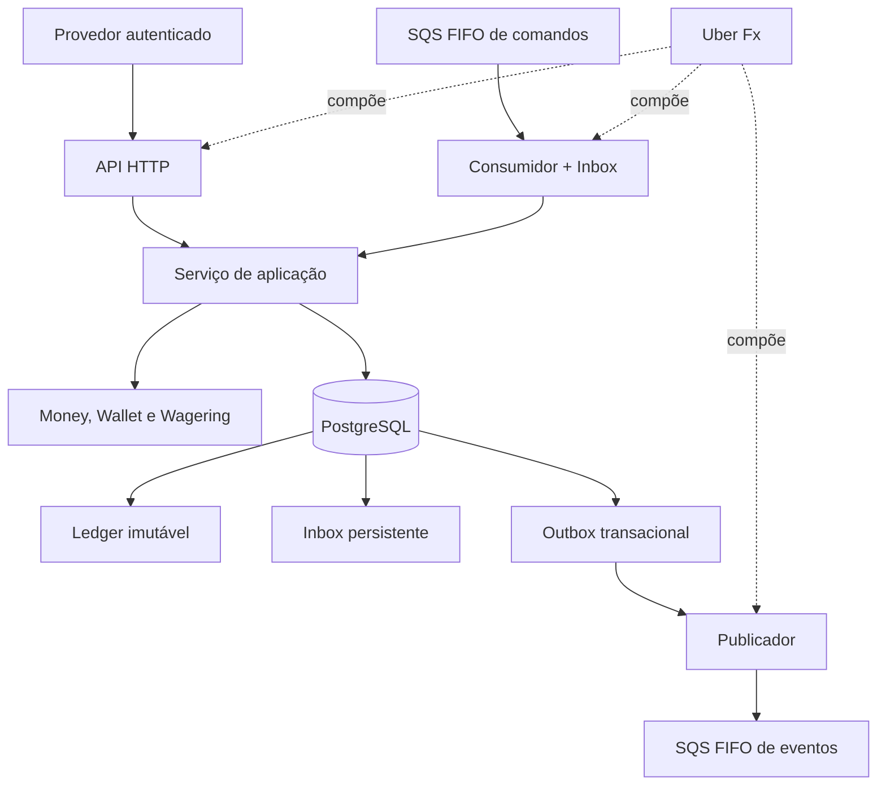

# Arquitetura e decisões técnicas

Este documento descreve as camadas do Wallet Service, as invariantes que protegem a integridade financeira, as decisões técnicas observadas no código e as limitações conhecidas. Os comandos e resultados de validação estão em [`docs/VALIDATION.md`](docs/VALIDATION.md); instruções de execução estão no [`README.md`](README.md).

> **Importante:** a descrição de uma capacidade e a execução bem-sucedida de um teste são evidências diferentes. Este documento não declara validada uma conta AWS real ou uma política IAM aplicada pelo LocalStack.

## 1. Objetivo e escopo

O serviço processa operações financeiras de provedores de jogos sobre carteiras de jogadores. API HTTP e consumidor SQS reutilizam o mesmo serviço de aplicação e as mesmas regras do domínio, para que a origem da operação não altere a semântica financeira.

As prioridades são precisão monetária, consistência de saldo, idempotência persistente, concorrência entre instâncias, ledger auditável e recuperação de mensagens/eventos após falhas.

## 2. Visão geral

### Princípios

- PostgreSQL é a fonte persistente da verdade financeira.
- A correção não depende somente da memória de uma instância.
- Operações sobre a mesma carteira são coordenadas sem bloquear globalmente carteiras distintas.
- Saldo, transação, ledger e eventos da Outbox são persistidos atomicamente quando a operação altera o estado financeiro.
- Mensagens podem ser entregues mais de uma vez; a deduplicação persistente é responsabilidade da aplicação e do banco, não somente do broker.

## 3. Organização em camadas

| Pacote | Responsabilidade |
|---|---|
| `internal/money` | Tipo monetário, parsing e aritmética segura |
| `internal/wallet` | Entidades e regras de carteira e ledger |
| `internal/wagering` | Tipos de operação, referências, estados e validações |
| `internal/app` | Casos de uso, transações SQL e coordenação entre domínio e persistência |
| `internal/httpapi` | Handlers, contratos HTTP, autenticação e autorização |
| `internal/auth` | Validação JWT e obtenção de chaves por JWKS |
| `internal/inbound` | Consumidor SQS e Inbox transacional |
| `internal/outbox` | Reivindicação e publicação de eventos persistidos |
| `internal/messaging` | Abstração de filas e adaptadores SQS/memória |
| `internal/metrics` | Métricas Prometheus |
| `internal/bootstrap` | Composição de dependências e ciclo de vida Uber Fx |
| `db/migrations` | Evolução versionada do schema PostgreSQL |

O domínio não depende dos handlers HTTP ou da implementação do banco. A camada de aplicação orquestra as regras e executa persistência dentro de transações SQL apropriadas.

## 4. Dinheiro e precisão

- Os valores são representados por `int64` em centavos; o PostgreSQL usa colunas inteiras (`BIGINT`).
- O parsing recebe strings decimais com exatamente duas casas, por exemplo `"25.00"`.
- Entradas vazias ou malformadas, sinal explícito, notação científica, escala diferente de duas casas e valores acima do limite suportado são rejeitados.
- Soma, subtração e negação verificam overflow; combinar moedas diferentes retorna `ErrCurrencyMismatch`.
- O código valida o formato e verifica os códigos de moeda com `golang.org/x/text/currency.ParseISO`. O código `XXX`, usado para representar ausência de moeda, é rejeitado para operações financeiras.
- Não há uso de ponto flutuante para aritmética financeira.

A representação canônica dos valores monetários ajuda a produzir hashes de payload consistentes na idempotência.

## 5. Persistência, transação e concorrência

### 5.1 Fluxo transacional

O processamento de uma operação financeira, em alto nível:

1. Inicia uma transação PostgreSQL com isolamento `READ COMMITTED`.
2. Bloqueia a linha da carteira com `SELECT ... FOR UPDATE`.
3. Consulta as chaves de idempotência e o identificador externo.
4. Valida a operação e as referências aplicáveis.
5. Persiste a transação, o lançamento de ledger quando aplicável, o novo saldo/versão e os eventos de Outbox.
6. Confirma a transação (`COMMIT`).

Quando uma operação é rejeitada por uma regra de negócio, a rejeição é registrada como resultado terminal. Entradas estruturalmente inválidas são erros de requisição e não operações financeiras executadas.

### 5.2 Proteções de concorrência

- **Lock por carteira:** as operações da mesma carteira são serializadas pelo lock da linha; carteiras diferentes podem progredir em paralelo.
- **Controle otimista de versão:** a atualização do saldo verifica a versão esperada.
- **Saldo não negativo:** constraint `CHECK (balance >= 0)` no PostgreSQL.
- **Consistência saldo/ledger:** um trigger diferido valida no commit se o saldo corresponde ao último saldo registrado no ledger.
- **Constraints de unicidade:** protegem idempotência, identificadores externos e lançamentos por transação/carteira.
- **Retentativas:** deadlocks, falhas de serialização e certas corridas de unicidade podem disparar retentativas limitadas no fluxo de aplicação.

O lock de linha por carteira foi escolhido para coordenar apenas operações que disputam o mesmo saldo, preservando paralelismo entre carteiras distintas.

## 6. Idempotência

A idempotência é persistida no PostgreSQL e sobrevive a reinícios e múltiplas instâncias.

- A API exige `Idempotency-Key`.
- O consumidor SQS obtém a chave do corpo da mensagem.
- Índices únicos parciais protegem `(provider_id, idempotency_key)` e `(provider_id, external_transaction_id)`.
- A chave é escopada por provedor. Nas chamadas HTTP, a identidade de provedor é determinada pelos claims autenticados, não por um valor arbitrário do cliente.

### Hash do payload

O serviço calcula SHA-256 do JSON canônico dos campos de negócio: `providerId`, `externalTransactionId`, `playerId`, `walletId`, `roundId`, `gameId`, `kind`, `money.amount`, `money.currency` e `referenceExternalTransactionId` (string vazia quando ausente). A chave de idempotência, correlation ID e metadados de transporte não fazem parte do hash.

### Repetição

- Mesma chave e mesmo payload: retorna o resultado original e `idempotentReplay: true`; não há nova movimentação.
- Mesma chave e payload diferente: responde `409 IDEMPOTENCY_KEY_CONFLICT`.
- Mesmo identificador externo com outra chave: responde `409 EXTERNAL_TRANSACTION_CONFLICT`.
- Replays respeitam o escopo do provedor e não podem revelar transações de outro provedor.

A deduplicação FIFO nativa do SQS tem uma janela limitada e é apenas uma defesa adicional; não substitui a idempotência persistida.

## 7. Regras de domínio e estados

### 7.1 Tipos de operação

| Tipo | Efeito no saldo | Regra principal |
|---|---|---|
| `BET` | Débito | Valor positivo e saldo suficiente |
| `WIN` | Crédito | Valor positivo; referência a `BET` compatível quando fornecida |
| `LOSS` | Nenhum | Exatamente `0.00`; sem lançamento no ledger e sem alteração da versão do saldo |
| `REFUND` | Crédito | Reembolsa integralmente uma `BET` processada |
| `ROLLBACK` | Inverso da referência | Reverte integralmente uma operação permitida pelas regras de domínio |
| `OPENING` | Crédito interno quando o saldo inicial é positivo | Usado exclusivamente na abertura interna da carteira |

Referências são resolvidas por provedor e identificador externo e precisam corresponder ao jogador, carteira, moeda e rodada esperados. Reversões parciais não são suportadas.

### 7.2 Estados

O domínio e o schema reconhecem `PENDING`, `PROCESSED`, `REJECTED`, `PENDING_REFERENCE` e `FAILED`.

- `PENDING_REFERENCE` é persistido quando uma operação válida depende de uma referência que ainda não chegou.
- `PROCESSED` e `REJECTED` são resultados terminais.
- `FAILED` existe no domínio e no schema, e sua transição é testada no domínio, mas nenhum caminho atual da aplicação o persiste.
- Falhas transitórias de infraestrutura provocam rollback da transação e são retornadas para que possam ser repetidas com segurança. O código não converte genericamente qualquer erro técnico em `FAILED`.
- Uma referência pendente que esgota as tentativas permitidas é encerrada como `REJECTED`, com código apropriado de referência não encontrada/não processada.
- O trigger do banco protege estados terminais; exclusões de transações são bloqueadas.

#### Política decidida para `FAILED` (não implementada)

`FAILED` fica reservado a uma falha **terminal, não de negócio e comprovadamente sem efeito financeiro**, por exemplo uma violação de invariante interna que se repete de forma determinística para o mesmo comando. A política é:

| Situação | Destino | Motivo |
|---|---|---|
| Regra de negócio (saldo, referência, valor...) | `REJECTED` com `failureCode` | Resultado definitivo e auditável |
| Indisponibilidade de infraestrutura, timeout, deadlock | Nada persistido; repetível (`503` / volta à fila) | A idempotência torna a repetição segura |
| Erro após `COMMIT` com resultado desconhecido | Nunca `FAILED`; reconsultar pela chave de idempotência | O commit pode ter sido aplicado; marcar `FAILED` mentiria |
| Falha interna determinística repetida | `FAILED` (futuro), somente numa transação própria e só quando a primeira transação foi desfeita | Evita laço infinito sem inventar rejeição de negócio |

Por que não foi implementado agora: nenhum caso conhecido exige o estado, e persistir `FAILED` por engano em uma falha transitória ou incerta bloquearia uma operação válida (o estado é terminal e a chave de idempotência ficaria presa). Enquanto isso, mensagens SQS que falham de forma repetida acabam na DLQ pelo redrive, e as requisições HTTP recebem `500`/`503` sem efeito persistido. Isso permanece registrado como limitação conhecida.

### 7.3 Códigos de rejeição de negócio

As rejeições definitivas incluem, conforme a regra aplicável: `INSUFFICIENT_FUNDS`, `REVERSAL_INSUFFICIENT_FUNDS`, `WALLET_PLAYER_MISMATCH`, `CURRENCY_MISMATCH`, `REFERENCE_NOT_FOUND`, `REFERENCE_NOT_PROCESSED`, `REFERENCE_MISMATCH`, `REFERENCE_KIND_INVALID`, `REVERSAL_AMOUNT_MISMATCH` e `ALREADY_REVERSED`.

JSON inválido, campos obrigatórios ausentes, valores inválidos e tipos desconhecidos são erros estruturais de requisição (`400`), não movimentos financeiros.

### 7.4 Reversões

Uma referência pode ter no máximo uma reversão bem-sucedida (`REFUND` ou `ROLLBACK`), protegida por índice único parcial. Uma segunda reversão não pode creditar/debitar o saldo novamente. A possibilidade de um `ROLLBACK` referenciar um `REFUND` segue as regras de domínio e não reabre a aposta original.

## 8. Referências pendentes

Quando uma referência ainda não existe, o serviço persiste a operação como `PENDING_REFERENCE`, retorna `202` e emite `WagerTransactionPendingReference`.

Um worker reprocessa pendências usando backoff exponencial. Antes de agir, ele bloqueia a carteira e reavalia o estado persistido. O limite de tentativas, o backoff e o intervalo do worker são configuráveis. Quando a referência chega, a operação pendente pode ser resolvida; se a referência não aparecer ou não for elegível após o limite, a pendência termina como rejeição conforme a política de domínio.

A pendência persiste no PostgreSQL e pode ser retomada após reinícios. O teste manual validado no ambiente local criou um `REFUND` antes da `BET`, reiniciou a API com a pendência persistida e confirmou que, após criar a aposta referenciada, o `REFUND` foi processado e o saldo foi recomposto sem crédito antecipado.

## 9. Ledger, Inbox e Outbox

### 9.1 Ledger imutável

`wallet_ledger_entries` registra direção, valor, saldo anterior e saldo posterior.

- Constraints verificam aritmética e valores positivos.
- `UNIQUE (wallet_id, transaction_id)` impede mais de um lançamento para a mesma transação e carteira.
- Triggers bloqueiam `UPDATE`, `DELETE` e `TRUNCATE` do ledger.
- `LOSS` e operações rejeitadas não geram lançamentos financeiros.
- A abertura da carteira com saldo inicial positivo registra o movimento `OPENING` e os eventos correspondentes na mesma transação.
- A reconciliação compara o saldo armazenado com a soma líquida do ledger; a verificação manual realizada no ambiente de desenvolvimento não encontrou divergências no conjunto consultado.

### 9.2 Outbox transacional

A tabela `outbox_events` é gravada na mesma transação que atualiza a operação, saldo e ledger. O envelope inclui `eventId`, `eventType`, `aggregateId`, `correlationId`, `causationId`, `occurredAt` em UTC, `version` e `data`.

O publicador envia eventos após o commit, com semântica de pelo menos uma vez. Uma falha depois do envio e antes de marcar o evento como publicado pode provocar o reenvio do mesmo `eventId`; consumidores downstream precisam deduplicar pelo identificador do evento.

### 9.3 Inbox transacional

A tabela `inbox_messages` usa chave primária `(consumer_name, message_id)`. O consumidor registra a inbox e processa a operação financeira na mesma transação SQL; a mensagem só é apagada do SQS após o commit.

- Falha antes do commit: a transação é revertida e a mensagem pode ser reentregue.
- Falha após o commit e antes de apagar a mensagem: a reentrega é reconhecida pela inbox e não reaplica o efeito financeiro.
- Mensagem repetida com o mesmo ID e payload: é confirmada sem novo efeito.
- Reutilização de um ID com payload diferente: é tratada como conflito e pode ser enviada à DLQ segundo a política do consumidor.

## 10. Mensageria SQS, retentativas e DLQ

O serviço provisiona duas filas FIFO e suas DLQs:

| Fila | Direção | `MessageGroupId` | `MessageDeduplicationId` |
|---|---|---|---|
| `wager-transactions.fifo` | Comandos de provedores/serviços para o Wallet Service | `walletId` | `idempotencyKey` |
| `wallet-events.fifo` | Eventos publicados pelo Wallet Service | `aggregateId` | `eventId` |

O grupo por carteira mantém a ordem das mensagens da mesma carteira e permite paralelismo entre carteiras. Os locks e a idempotência do PostgreSQL continuam sendo as garantias finais.

### Consumidor

- Usa o mesmo caso de uso da API e contrato de negócio, com `idempotencyKey` no corpo da mensagem.
- Falhas transitórias, como indisponibilidade do banco ou deadlock, provocam retry com backoff/visibilidade até o limite configurado.
- Mensagens estruturalmente inválidas e conflitos de idempotência podem ser encaminhados diretamente à DLQ.
- Rejeições de negócio são resultados válidos; a transação é persistida como `REJECTED` e a mensagem é confirmada.
- O encerramento para de buscar novas mensagens e permite que o trabalho em andamento termine dentro do prazo configurado.

### Publicador da Outbox

- Reivindica lotes com `FOR UPDATE SKIP LOCKED` e lease temporária (`locked_by`, `locked_until`).
- Mantém a ordem dos eventos de cada agregado.
- Registra tentativas/erros e define `next_attempt_at` com backoff em caso de falha.
- Se o publicador cair, a lease expira e outro publicador pode reivindicar o evento.
- Se o evento foi enviado mas o registro de sucesso não foi salvo, ele pode ser reenviado com o mesmo `eventId`.

Eventos de domínio incluem `WagerTransactionProcessed`, `WagerTransactionRejected`, `WagerTransactionPendingReference` e `WalletBalanceChanged`.

### Escopo de segurança do SQS

Em produção, as permissões IAM devem seguir o princípio do menor privilégio: produtor, consumidor e publicador só devem ter acesso às filas de que necessitam. A política IAM não é aplicada como garantia de segurança pelo LocalStack usado no Compose. A integração com uma conta AWS real não foi validada nesta execução. Mensagens SQS são confiadas ao canal de mensageria configurado; elas não carregam validação de JWT por mensagem.

## 11. Autenticação e autorização

### Provedor de identidade

O ambiente local usa Keycloak, realm `wallet` e fluxo OAuth 2.0 `client_credentials`. A aplicação não armazena senhas de usuários nem emite tokens próprios.

### Validação JWT

A validação exercitada nos testes inclui:

- assinatura `RS256` com chave pública obtida por JWKS;
- emissor esperado (`iss`);
- expiração (`exp`), rejeitando tokens expirados ou sem o claim obrigatório;
- audiência (`aud`), rejeitando audiência ausente ou incorreta;
- recusa de algoritmos não aceitos, como `HS256`;
- rejeição de `kid` desconhecido, assinatura de outra chave, token malformado e incoerência entre claims do cliente como `azp` e `client_id`;
- rotação/atualização de chaves JWKS e tratamento de indisponibilidade do IdP exercitados pelos testes de autenticação.

Se a indisponibilidade do IdP impedir a validação, o serviço pode responder `503`, em vez de classificar incorretamente o token como inválido (`401`).

### Autorização

- `azp`/client ID identifica o cliente autenticado e delimita a identidade de provedor.
- Os papéis utilizados são `wallet-provider` e `wallet-internal`.
- Provedor só pode submeter e consultar suas próprias transações.
- Divergência entre o provedor do token e o solicitado é negada; recursos fora do escopo podem retornar `404` para não revelar sua existência.
- Abertura de carteira, consulta de carteira, ledger e reconciliação exigem papel interno.
- Requisições não autorizadas não devem causar movimentações financeiras.

Introspecção/revogação de tokens e rotação operacional de segredos não estão implementadas. As credenciais do realm de desenvolvimento não devem ser usadas em produção.

## 12. Composição e ciclo de vida com Uber Fx

`internal/bootstrap` compõe configuração, pool PostgreSQL, serviço de aplicação, verificador JWT, API HTTP, worker de referências pendentes, consumidor SQS e publicador da Outbox.

Na inicialização, a aplicação valida a configuração e tenta estabelecer as dependências essenciais. No encerramento, o servidor para de aceitar novas conexões e aguarda requisições em andamento; consumidores/publicadores e o worker encerram de forma controlada; por último, o pool do banco é fechado. Os testes de ciclo de vida verificam inicialização e encerramento gracioso.

`MESSAGING_ENABLED=false` permite desativar componentes de mensageria em contextos específicos, como testes de ciclo de vida.

## 13. Observabilidade

Logs estruturados usam `slog` e carregam, quando disponíveis, `correlationId`, `transactionId`, `walletId` e `providerId`, sem registrar credenciais nem o payload completo da transação.

- `GET /health/live`: liveness do processo.
- `GET /health/ready`: prontidão das dependências configuradas.
- `GET /metrics`: métricas no formato Prometheus; restrinja o acesso por rede/camada de infraestrutura em produção.

As métricas incluem resultados e duração de operações, replays idempotentes, conflitos, retry de referências pendentes, resultados de consumo SQS, publicações/falhas de Outbox, backlog e resultados de reconciliação. O redrive de uma mensagem para a DLQ executado internamente pelo broker não é necessariamente contado diretamente como evento de métrica da aplicação.

## 14. Contratos HTTP e códigos de resposta

| Situação | HTTP | Código/corpo típico |
|---|---:|---|
| Operação processada ou replay | `200` | `status: PROCESSED`; `idempotentReplay` quando aplicável |
| Referência aguardando resolução | `202` | `status: PENDING_REFERENCE`, `nextAttemptAt` |
| Carteira criada | `201` | `id`, `playerId`, `balance`, `version` |
| Entrada inválida/chave ausente | `400` | `INVALID_REQUEST`, `MISSING_IDEMPOTENCY_KEY` |
| Token ausente/inválido | `401` | `UNAUTHORIZED` e `WWW-Authenticate` |
| Acesso negado/provedor incompatível | `403` | `FORBIDDEN`, `PROVIDER_MISMATCH` |
| Recurso inexistente | `404` | `WALLET_NOT_FOUND`, `TRANSACTION_NOT_FOUND` |
| Conflito de idempotência/identificador/carteira | `409` | `IDEMPOTENCY_KEY_CONFLICT`, `EXTERNAL_TRANSACTION_CONFLICT`, `WALLET_ALREADY_EXISTS` |
| Rejeição de negócio | `422` | `status: REJECTED`, `failureCode` |
| PostgreSQL/IdP indisponível | `503` | `SERVICE_UNAVAILABLE` ou `IDENTITY_PROVIDER_UNAVAILABLE` |

A lista resume os contratos principais; o código dos handlers é a fonte final para detalhes de payload e comportamento.

## 15. Estratégia de testes e evidências

- **Unitários:** dinheiro, domínio, estados e autenticação.
- **Integração PostgreSQL (`-tags integration`):** concorrência, idempotência, constraints, referências pendentes, reversões, isolamento e ciclo de vida.
- **Keycloak (`-tags keycloak`):** validação de tokens contra o IdP real de desenvolvimento.
- **LocalStack (`-tags localstack`):** consumidor, duplicatas, redelivery, retry, DLQ e publicação da Outbox no SQS real do LocalStack.
- **Concorrência multiprocesso:** processos independentes disputando a mesma carteira.
- **Reentrega após commit:** `TestSQSDeleteFailureAfterCommitIsHarmless` simula uma falha na primeira chamada de exclusão após o commit; o SQS real reentrega a mensagem, e a Inbox evita um segundo débito.

Os comandos e os resultados registrados para o ambiente de desenvolvimento estão em [`docs/VALIDATION.md`](docs/VALIDATION.md). Os testes LocalStack não equivalem a uma validação em uma conta AWS real.

## 16. Limitações conhecidas e trabalho futuro

| Item | Situação |
|---|---|
| Persistir `FAILED` em um fluxo terminal definido | Estado existe; nenhum caminho atual da aplicação o persiste |
| Introspecção/revogação de tokens | Não implementada |
| Rotação operacional de segredos | Não implementada |
| Aplicação da política IAM no LocalStack | Não aplicada pelo Compose |
| Integração com AWS real | Não validada nesta execução |
| Tracing OpenTelemetry | Não implementado |
| Partidas dobradas | Não implementadas |
| Testes de carga | Não realizados |

### Decisão sobre `FAILED`

Não se transforma automaticamente qualquer erro técnico em `FAILED`: falhas transitórias precisam poder ser repetidas, e um erro durante o `COMMIT` pode deixar o resultado incerto. Uma implementação futura precisa definir quais falhas são comprovadamente permanentes, em que transação o estado terminal é gravado e como evitar marcar como falhada uma movimentação que já foi confirmada.

### Segurança no ambiente local

- `go.mod` declara Go `1.27.2` e o Dockerfile usa uma imagem de build dessa mesma versão.
- Testes marcados `integration`, `keycloak` e `localstack` requerem serviços reais correspondentes.
- As credenciais do realm/Compose são somente de desenvolvimento.
- O LocalStack fornece integração de desenvolvimento para SQS; não substitui validação de permissões IAM e operação em AWS real.

## 17. Manutenção desta documentação

Atualize este documento quando alterar regras financeiras, estados, segurança, persistência ou mensageria. Descreva um comportamento como implementado somente após conferir o caminho de código correspondente; registre separadamente os comandos e resultados dos testes que realmente foram executados. Ao remover uma limitação, atualize também a lista de limitações do README.
